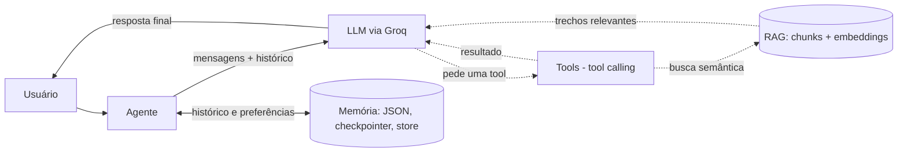

# Aprendendo a criar agentes de IA

Trilha de estudo que constrói o mesmo tipo de agente de IA (chat, tool calling, memória e RAG) em três níveis de abstração (SDK puro, LangChain e LangGraph) e junta tudo em um agente de suporte com memória e RAG.

> **Status: em andamento.** Este é um projeto de estudo que continua sendo evoluído. Não é um produto finalizado.

## O problema / objetivo

Frameworks de agentes escondem boa parte do que acontece por baixo. O objetivo aqui é aprender a construir o mesmo agente em três níveis de abstração (SDK direto, LangChain e LangGraph) para entender o que cada framework faz por baixo: o loop de tool calling, o gerenciamento de histórico e memória, e a recuperação de documentos (RAG).

## Como funciona



A mesma ideia é implementada em três etapas, e uma quarta reúne tudo em um agente de suporte:

1. **`01_do_zero/`**: o loop agêntico escrito à mão com o SDK da Groq (mensagens, tools, validação, memória em arquivo JSON).
2. **`02_langchain/`**: o mesmo com `ChatGroq`, `@tool` e `create_agent`; o loop de tools vem pronto e a memória usa um checkpointer.
3. **`03_langgraph/`**: o agente como grafo (estado, nós, arestas condicionais), com checkpointer e store, embeddings, busca semântica, chunking e um RAG básico sobre os arquivos de `03_langgraph/docs/`.

### Trilha

| Etapa | Pasta | O que se aprende |
|---|---|---|
| 1. Do zero | [01_do_zero/](01_do_zero/) | SDK da Groq (e OpenAI-compatível) puro: loop de chat, tool calling, validação, memória em JSON |
| 2. LangChain | [02_langchain/](02_langchain/) | Os mesmos conceitos com `ChatGroq`, `@tool` e `create_agent` |
| 3. LangGraph | [03_langgraph/](03_langgraph/) | Agente como grafo: estado, nós, arestas condicionais, checkpointer, store, embeddings e RAG |
| 4. Agente final | [04_agente_final/](04_agente_final/) | Agente de suporte em terminal: grafo, memória de longo prazo e RAG em Chroma, checkpoint em SQLite e pedidos de demonstração (em desenvolvimento) |
| Extra | [colab/](colab/) | Notebook do workshop |
| Extra | [chat/](chat/) | Interface de chat em Next.js (ver abaixo) |

**01_do_zero**
1. `01_chat.py`: chat simples com histórico
2. `02_tool_calling.py`: loop agêntico, tools com parâmetros, tratamento de erros
3. `03_tool_calling_memoria.py`: memória persistente (`memoria.json`)
4. `04_chat_neuralake.py`: mesmo chat usando outro provedor via SDK da OpenAI

**02_langchain**
1. `01_chat.py`: `ChatGroq` e classes de mensagem no lugar de dicts
2. `02_tool.py`: `@tool` e `create_agent`
3. `03_memoria.py`: histórico entre turnos com checkpointer

**03_langgraph** (cada arquivo evolui o anterior)
1. `01_fundacao.py`: grafo mínimo
2. `02_tool_horario.py`: tool + nó condicional
3. `03_historico.py`: histórico entre perguntas
4. `04_multiplas_escolhas.py`: nova tool
5. `05_memoria.py`: memória em JSON feita à mão
6. `06_memoria_langgraph.py`: checkpointer e store nativos
7. `07_embeddings.py`: embeddings e similaridade
8. `08_busca_semantica.py`: busca semântica no store
9. `09_documentos.py`: chunking e indexação
10. `10_rag_basico.py`: RAG básico (documentos em `docs/`)
11. `11_rag_citacoes.py`: citações das fontes com limiar de similaridade
12. `12_avaliacao.py`: avaliação da recuperação
13. `12_rag_persistente.py`: índice Chroma persistente

### 04_agente_final

Agente de atendimento de uma loja fictícia, em chat de terminal (`python 04_agente_final/main.py --user joao`; os clientes de demonstração com pedidos são `joao` e `maria`). O grafo faz `recall` (busca na memória de longo prazo) e depois alterna entre o modelo e as tools, com o histórico guardado em SQLite. A memória por usuário e a base de conhecimento (RAG com limiar de similaridade e citação da fonte) usam o Chroma e os mesmos embeddings do `03_langgraph`. **Esta etapa está em desenvolvimento** e não foi validada aqui.

### A pasta `chat/`

É um app Next.js com uma interface de chat, feito como teste de interface. **Ela não chama nenhum modelo de linguagem**: a tela envia a mensagem para `POST /api/messages`, que valida o texto (JSON válido, não vazio, até 500 caracteres) e devolve a própria mensagem com um id gerado. O arquivo `chat/app/api/chat/route.ts` está vazio. A dependência `openai` consta no `package.json`, mas não é usada no código. Os agentes de verdade estão nas pastas Python.

## Stack

- Python, com `groq` e `openai` (SDKs), `langchain` / `langchain-groq`, `langgraph`, `sentence-transformers` (embeddings, modelo `paraphrase-multilingual-MiniLM-L12-v2`), `chromadb`, `langgraph-checkpoint-sqlite`, `numpy`, `rich`, `python-dotenv`
- Modelos de chat via Groq: `openai/gpt-oss-20b` e `openai/gpt-oss-120b`; um provedor OpenAI-compatível (Neuralake) em `01_do_zero/04_chat_neuralake.py`
- Next.js, React e TypeScript na pasta `chat/`

## Meu papel

Projeto de estudo individual. Pelo `git log`, os 17 commits (sem contar merges) são do autor, João Pedro Panza Mainieri.

## Contexto

Projeto da Residência em IA, Formação avançada em Inteligência Artificial (PUCC e Instituto de Pesquisas Eldorado): https://formacao.eldorado.org.br/residencia-ia-pucc. Foi desenvolvido no contexto da organização Equilibrium-Residencia-IA.

## Como rodar localmente

Pré-requisito: Python 3 e uma chave de API da Groq.

```bash
python -m venv .venv && source .venv/bin/activate
pip install -r requirements.txt
cp .env.example .env   # preencha as chaves
```

Variáveis de ambiente (nomes lidos dos scripts):

| Variável | Onde é usada |
|---|---|
| `GROQ_API_KEY` | `01_do_zero/02` e `03`, todos os de `02_langchain/` e os de `03_langgraph/` que chamam o modelo |
| `GROQ_AI_KEY` | somente `01_do_zero/01_chat.py` |
| `NEURALAKE_API_KEY` | `01_do_zero/04_chat_neuralake.py` |

**Inconsistência conhecida:** `01_do_zero/01_chat.py` lê `GROQ_AI_KEY`, enquanto os demais scripts leem `GROQ_API_KEY`. Para rodar o primeiro é preciso definir as duas variáveis (ou ajustar o script). Ainda não foi corrigido.

Execute os scripts a partir da raiz, por exemplo `python 03_langgraph/01_fundacao.py`. Os scripts de embeddings e RAG usam `sentence-transformers`, que baixa um modelo na primeira execução. O `memoria.json` é gerado em tempo de execução e está no `.gitignore`.

Para a interface em `chat/`: `cd chat && pnpm install && pnpm dev` (scripts definidos em `chat/package.json`; não testado).
